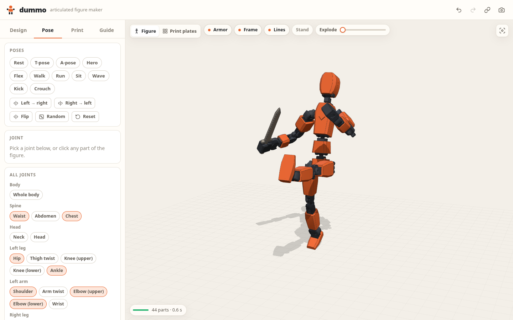
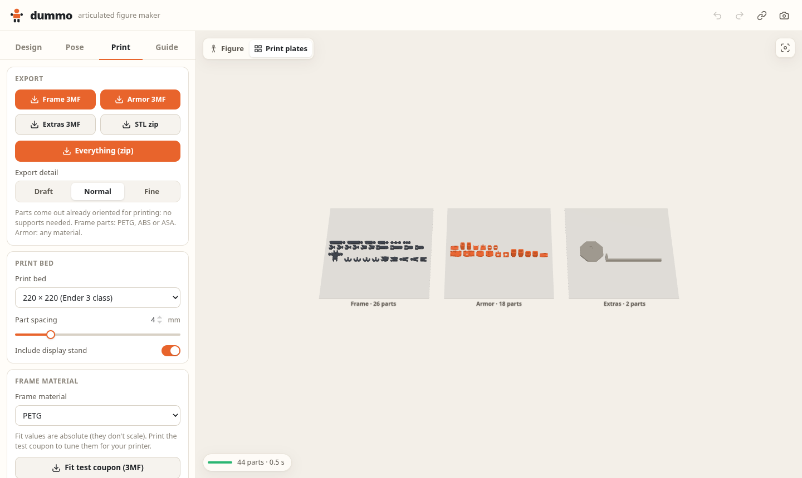

# dummo

**Design, pose and export 3D-printable articulated action figures, right in the browser.**

Pick proportions and an armor style, pose the figure, and download print-ready plates. Every
part comes out already oriented for printing, with snap-fit joints and no supports needed.

**[Open dummo →](https://souzagab.github.io/dummo/)**



## Features

- **Parametric body**: 11 proportion controls (torso, shoulders, hips, neck, limbs) plus a global
  scale from 60% to 250%. Presets: Standard, Heroic, Slim, Chibi, Brute.
- **Armor styling**: head shapes (egg, round, block, visor), head size, chest width, limb bulk,
  facet amount, an engraved chest emblem, and an on/off switch for each armor piece.
- **Character skins**: load any humanoid model (STL, OBJ, GLB/glTF, 3MF, PLY) and turn it into
  posable, printable armor on the dummo frame. The skeleton fits itself to the model (proportions,
  arm and leg angles, placement); open, hollow or messy meshes are solidified automatically.
- **Hands and gear**: fist, open or grip hands. Grip hands can hold a printable sword or staff.
- **Posing**: 25 joints with real joint limits, pose presets (T-pose, Hero, Walk, Run, Kick…),
  mirroring, random poses. Click any part to grab its joint. The figure stays on the ground
  automatically.
- **Print-ready export**: plates packed for your bed (180–300 mm or custom) as 3MF with colors,
  per-part STLs, or a single zip with everything. Choose Draft, Normal or Fine detail.
- **Fit tuning**: material presets (PETG, ABS/ASA, PLA, resin), adjustable interference values,
  and a printable fit-test coupon for dialling in your printer.
- **Display stand** that plugs into a port in the figure's back.
- Exploded view, part outlines, print-plate preview, screenshots, undo/redo, autosave, share
  links, and save/load of `.dummo.json` design files.



## How the figures work

Every figure is built from two layers.

**Frame.** All the joints live in the frame, printed in PETG, ABS or ASA. Every frame part is a
5 mm slab that prints flat. Ball stems and bridged slots are flattened so the parts print cleanly
without supports.

| Joint | Where | How it holds |
|---|---|---|
| Ball + C-socket | spine, neck, hips, shoulders, wrists, ankles | the socket is a little smaller than the ball, and the split ring flexes to snap it in |
| Double hinge | knees, elbows | a link with V-ridges clicks onto grooved pins; two pivots give a deep bend |
| Swivel | thigh and upper-arm twist | a disc slides into a T-slot; a printed leaf spring keeps it under tension |

**Armor.** Torso and head armor are two-piece shells that close around the frame with
press-fit pegs. Limb armor is a sleeve that slides on and is held by crush ribs. The feet take the
ankle's tongue.

Fit values (interference and clearance) are absolute: they stay the same at every scale, because
printer error doesn't grow with the model.

### Character skins

**Fitting the skeleton.** The model is stood up and scaled, then voxelized. Shortest paths through
the solid from the belly (weighted to stay on the limbs' centre lines and to cross small gaps
between separate pieces) end at the head, hands and feet. A first guess comes from those paths
and cross-sections. An optimizer then adjusts the proportions, limb angles and position until the
bones lie inside the model, reach its hands and run along its medial axis. It handles T-pose,
A-pose and arms-down models, fused sculpts and statues made of separate pieces.
`scripts/fitcheck.ts` checks it on 70 generated bodies (thin to chubby, big heads, five
proportion presets, three poses); joints land within about 6 mm.

**Building the armor.** An imported model is voxelized and sealed: gaps narrower than a set radius close, so open shells
and overlapping parts become one solid. Near the real surface, the voxel distances are replaced
with exact point-to-triangle distances, so flat faces, crests and slits survive. Each bone of the
rig, in the pose the model was bound in, claims the nearest part of the solid. Each region is then
meshed with a level set and handed to the regular armor builders as their outer shape.

Those builders still add every mechanical cut: frame pockets, joint swing clearance, slide-on
channels, dowel holes, and collars around the hip and shoulder swivels. Two more rules make any
body print and move:

- *Carve for movement*: the chest, abdomen and pelvis lose what the upper arms and thighs sweep
  through over their range (swings and twists), the thighs what the shins sweep at the knee, and
  so on down to the ankles.
- *Cover thin spots*: where the model is thinner than the frame, the leanest standard armor fills
  in, so no joint is left bare.

`scripts/posecheck.ts` poses a skinned figure through every preset and reports armor that would
collide.

There is also a headless version:

```bash
node scripts/skin.ts model.stl out/ [--height=140]   # fit, skin, print-ready parts + preview
node scripts/skin.ts model.stl out/ spec.json        # use your own proportions and bind pose
```

## Development

```bash
npm install
npm run dev        # local dev server
npm run check      # build every part for every preset; validate solids and test for collisions
npm run fitcheck   # skeleton auto-fit on generated bodies
npm run build      # type-check + production build into dist/
```

Requires Node 24 (the check script runs TypeScript directly).

### Layout

```
src/
  core/
    geometry/      joint primitives (kit), frame parts, armor, skins, stand, weapons, test coupon
    catalog.ts     every part: how it's built and where it mounts on the rig
    skeleton.ts    joint hierarchy, pivots, limits
    pose.ts        forward kinematics + pose presets
    layout.ts      bed packing
    export.ts      STL / 3MF / zip writers
  worker/          geometry runs in a Web Worker (manifold-3d, WebAssembly)
  viewer/          three.js scene, posing, plates view
  ui/              panel and controls
scripts/check.ts   headless geometry, watertightness and collision tests (run in CI before deploying)
scripts/skin.ts    headless character-skin builder
scripts/fitcheck.ts, posecheck.ts   auto-fit accuracy and range-of-motion tests
```

Pushing to `main` runs the checks, builds, and deploys to GitHub Pages.

Built with [three.js](https://threejs.org), [manifold-3d](https://github.com/elalish/manifold),
[fflate](https://github.com/101arrowz/fflate) and [Vite](https://vite.dev).
